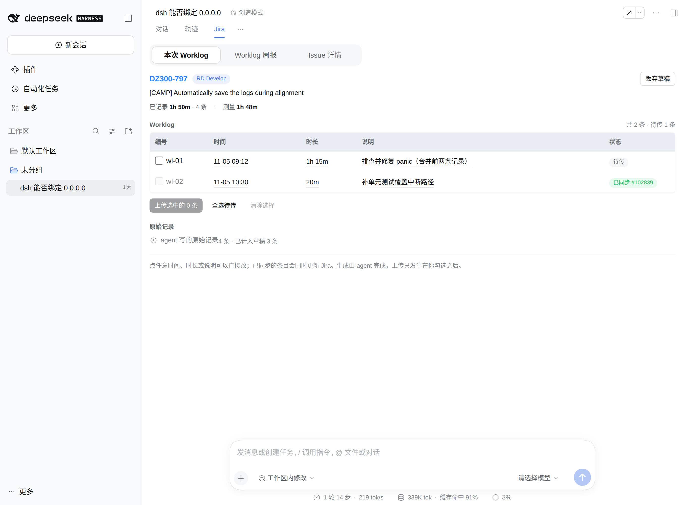

# @ian/sc-jira

DSH plugin: a Jira integration for the session you are working in.

- **Conversation view** (the tab next to Trajectory), four sub-tabs:
  **本次 Worklog** / **我的未完成** / **Worklog 周报** / **Issue 详情**.
- **Ticket chip** in the strip under the composer: the ticket this session is bound to, with its
  status. It renders nothing while the session is unbound. The worklog tab shows the bound ticket,
  the entries with their times, and the agent's raw records; every time, duration and note is
  editable in place, and a synced row's edit is pushed to Jira first.
- **Configuration card** (`插件 → 已安装插件 → @ian/sc-jira`): server / login / API token /
  display name / proxy
- **Tools** (9): 3 reads, and the 6 that run the worklog flow
- **Commands** (3): `/jira-bind`, `/jira-unbind`, `/jira-worklog` — a command runs against the
  agent **without** creating a model message
- **HTTP routes**, all under `/api/scjira/*`: `status`, `config`, `list-worklog-week`, `issue`,
  `worklog`, `worklog/edit`, `worklog/upload`, `worklog/discard`

## What it does

A session binds one Jira ticket, works through it with the agent, and finally turns that work into
a worklog on the tracker:

```
/jira-bind DZ300-797            ← one session, one ticket
   │
   ├─ agent records as it goes ← jira_record_activity("定位 panic 到 local_irq_enable", 1800)
   │                             (seconds may be omitted: the host measures since the last record)
   │
   ├─ the turn ends            ← the host turns that turn into ONE worklog line:
   │                             duration = the turn's measured time, comment = the agent's words
   │
   └─ panel: tick → upload      ← jira_upload_worklog({ ids }) or the 本次 Worklog panel
```

The division of labour is the point:

- **The agent explains, while it works.** Only the agent knows what it was doing, so it writes the
  activity records — and that one sentence becomes the Jira worklog comment. Nothing has to be
  summarized afterwards, which is why the session can be compacted without losing the worklog.
- **The host measures.** Every turn's span is recorded (`agent/turn-stopping`), and when a turn ends
  the host turns it into one draft entry: the measured duration, the agent's sentences, the records
  it covers. No model, no conversation, no tokens — a clock reading and a string the agent already
  wrote. A turn shorter than the policy floor, or one the agent recorded nothing in, produces no
  entry: chatter is not work.
- **The human decides.** Nothing reaches Jira until a person selects entries and uploads them; a
  synced entry is final, and a rejected upload stays retryable.

The agent can still group or reword the records itself with `jira_generate_worklog` — while it still
has the context. That is the tool's job now, not the automatic line's.

The design this implements is **[docs/design/v4-worklog-redesign.md](docs/design/v4-worklog-redesign.md)**.
Historical designs are kept in `docs/design/v3-session-binding.md` and `docs/specs/`.

## Data

One file per session — the plugin's only local state:

```
~/.dsh/profiles/web/scjira/sessions/{sessionId}.json
  binding     key / summary / statusName / url / boundAt
  activities  what the agent recorded: summary + startedAt + seconds + turn
  turns       what the host measured: turn span (never billed on its own)
  draft       entries generated from the activities, each with state
              draft | synced | failed, its jiraId, and the activityIds it covers
```

The directory is `storeDir` in the plugin config. Writes are read-modify-write into a temporary
file and renamed into place, serialized per session. A file that cannot be parsed is reported and
**left untouched** — it is the only copy of the records.

`jira_bind` starts a round; `jira_unbind` ends it. Both are refused while the round still has
records that never reached Jira.

## Tools

| Tool | What it does |
|---|---|
| `jira_bind {taskKey}` | Bind this session (one ticket per session) |
| `jira_unbind` | End the binding, once everything is uploaded |
| `jira_record_activity {summary, seconds?, startedAt?}` | Record one piece of work |
| `jira_worklog_state` | Binding, activities, measured vs recorded, gap, draft |
| `jira_generate_worklog {entries?}` | Group or reword unbilled activities into a draft |
| `jira_upload_worklog {ids}` | Upload the selected entries (empty selection = show what is pending) |
| `jira_list_my_open` | Unresolved issues assigned to me |
| `jira_list_worklog_week {startDate?}` | One week of my Jira worklogs |
| `jira_issue {key}` | One issue with its description and comments |

The automatic line is on by default (`worklog.autoGenerate`); the policy that shapes it lives in the
plugin config:

| Setting | Default | What it does |
|---|---|---|
| `worklog.autoGenerate` | `true` | Make one worklog line for every finished turn |
| `worklog.minSeconds` | `60` | A turn shorter than this is chatter and produces no line |
| `worklog.rounding` | `60` | Durations round UP to a multiple of this |
| `worklog.maxSecondsPerActivity` | `14400` | One line may not claim more than this |

`jira_generate_worklog` without arguments is deterministic: one draft entry per activity, verbatim.
With `entries` the agent may merge or reword — but every unbilled activity must be covered exactly
once, and the total is checked against the records: a mismatch is reported as `deltaSeconds`, not
silently accepted and not refused.

## Install

### From GitHub

```bash
dsh plugin --profile web add github:1an-Y1n/sc-jira-dsh
```

A git install fetches **sources, not built artifacts**, and this package ships a `prepare` script
that pnpm runs after the install. pnpm asks for approval per resolved commit, so the **first**
`add` fails; copy the key pnpm prints into the profile's `pnpm-workspace.yaml`:

```yaml
# ~/.dsh/profiles/web/pnpm-workspace.yaml
allowBuilds:
  '@ian/sc-jira@https://codeload.github.com/1an-Y1n/sc-jira-dsh/tar.gz/<commit>': true
```

then re-run the `add`. Allowing a build is permission to execute this package's code at install
time — it is the same permission the plugin already has at runtime, so approve the commits you
actually installed.

### From a local checkout

```bash
pnpm install
pnpm run build            # tsc + tsdown client bundle + CJS-prelude wrap
dsh plugin --profile web add "$(pwd)"
```

Either way, restart `dsh web` afterwards, then fill in the credentials in
**插件 → 已安装插件 → @ian/sc-jira**.

### Uninstall

```bash
dsh plugin --profile web remove @ian/sc-jira
```

## Configure

| Field | Notes |
|---|---|
| `server` | Jira Server root, e.g. `https://jiraprod.sercomm.com` |
| `login` | The account API calls authenticate as |
| `token` | API token; stored as a secret and never sent back to the client |
| `displayName` | Used to match "my" worklogs (`login` OR `displayName`) |
| `proxy` | Optional; `HTTPS_PROXY` / `HTTP_PROXY` win when set |
| `storeDir` | Where the session documents live (default as above) |
| `worklog.minSeconds` | A measured interval shorter than this is refused (default 60) |
| `worklog.rounding` | Measured durations round **up** to this step (default 60) |
| `worklog.maxSecondsPerActivity` | Per-activity cap (default 4h) |
| `worklog.autoGenerate` | Make one worklog line for every finished turn (default on) |

## Tests

```bash
pnpm test                 # vitest
pnpm run typecheck        # host + client
```

## Routes

| Route | Method | Purpose |
|---|---|---|
| `/api/scjira/status` | GET | Credential state (works without a token) |
| `/api/scjira/config` | POST | Write a partial settings change |
| `/api/scjira/list-my-open` | GET | Issues assigned to me that are still open |
| `/api/scjira/list-worklog-week` | GET | Weekly report |
| `/api/scjira/issue` | GET | One issue with comments |
| `/api/scjira/worklog?sessionId=` | GET | The session's worklog document + totals |
| `/api/scjira/worklog/edit` | POST | Edit a draft entry (a synced one is pushed to Jira first) |
| `/api/scjira/worklog/activity` | POST | Edit or delete one raw record (`delete: true` to remove) |
| `/api/scjira/worklog/delete-entry` | POST | Drop one draft entry (a synced one stays) |
| `/api/scjira/worklog/upload` | POST | Upload selected entries |
| `/api/scjira/worklog/discard` | POST | Discard drafts (synced entries stay) |

## Jira API notes

- Jira **Server** REST **v2** (`/rest/api/2`).
- A worklog body takes **`timeSpent`** (a duration string such as `1h 30m`), not
  `timeSpentSeconds`; `started` accepts an ISO timestamp with an offset. `adjustEstimate` is
  rejected by this Jira version, so no estimate linkage is attempted.
- Timestamps are written with a fixed `+0800` offset: the server runs on Asia/Taipei, which shares
  the offset with Asia/Shanghai, so a backdated entry lines up with the working day it belongs to.
- `JiraClient` shells out to `curl` via `child_process` (the sandbox permits spawn but not the
  network stack from `fetch`). The spawn function is injectable, which is how the tests fake it.

## Files

- `src/index.ts` — `apply`: config, routes, tools, hooks, commands
- `src/types.ts` — Jira read shapes and the worklog document
- `src/session-store.ts` — the per-session document (atomic write, serialized per session)
- `src/time-policy.ts` — timestamp format, duration derivation, the gap
- `src/worklog.ts` — pure rules: what is billable, generation, summarization
- `src/worklog-handlers.ts` — the IO side: bind / record / generate / upload / edit / discard
- `src/handlers.ts` — the reads: my open issues, one week, one issue
- `src/jira-client.ts` — curl-backed REST client
- `src/tool.ts` / `src/lossless.ts` — the tool boundary that makes every value lossless JSON
- `src/client/` — locale, settings card, the three-tab view, the worklog panel, shared theme

## The 本次 Worklog tab



The 我的未完成 tab is the account-wide read (`docs/screenshots/open-issues-tab.png`):
key, summary, status, priority, due date and time spent, one row per open issue.

The tab leads with the bound ticket, then the worklog rows (id, time, duration, note,
state) and finally the agent's raw records behind a disclosure row. Click any time,
duration or note to edit it in place; a synced row's edit is pushed to Jira first.
`docs/screenshots/worklog-tab-records.png` shows the raw records, and
`worklog-tab-edit.png` the inline editor.
